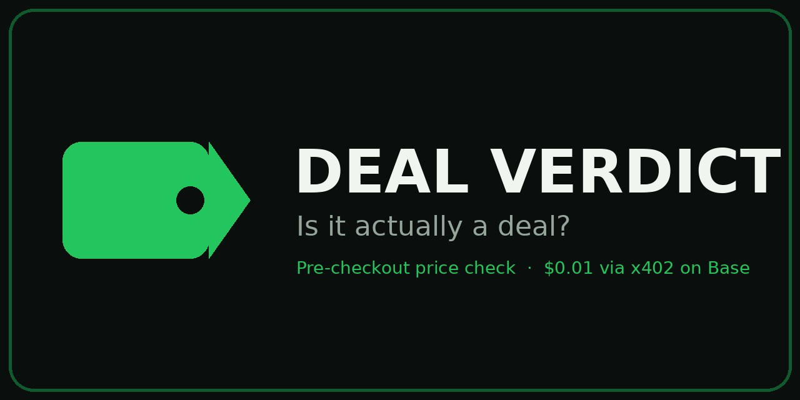

# @thewinnerscircle/plugin-deal-verdict

Deal Verdict for ElizaOS — a pre-checkout "is this actually a deal?" check for shopping agents, paid per call via x402.



## What it does

One action, **CHECK_DEAL**: when a purchase, checkout, or sale price is being considered, the agent calls Deal Verdict *before* buying and replies with the verdict card.

```
POST https://x402-web-reader.vercel.app/api/deal-verdict
Body: { "product": "Apple AirPods Pro 2", "price": 189, "compareAtPrice": 249 }
Price: $0.01/call, USDC on Base via x402 — no API key
```

- `product` — product name or product page URL (required)
- `price` — the price the agent found, in USD (required)
- `compareAtPrice` — the claimed "was" price, if the listing shows one (optional)
- `url` — the product page URL (optional)

Returns: `verdict` (`real_deal` / `fake_discount` / `overpriced` / `fair`), `lowestFound` (price + source + store), `typicalPrice`, `savingsVsTypical`, and the cited `sources` behind every price. Prices come from live web search across major retailers; every number is extracted from a cited source, never invented. If fewer than 3 priced sources can be found, the endpoint returns HTTP 502 and the call is **never charged**.

## Gate rule

```
real_deal / fair            → buy at this price
fake_discount / overpriced  → DO NOT buy here — use lowestFound instead
```

The gate fails closed: an unknown verdict never authorizes a purchase at the checked price.

## Install

```bash
elizaos plugins add @thewinnerscircle/plugin-deal-verdict
# or: npm install @thewinnerscircle/plugin-deal-verdict
```

Add to your character:

```json
{ "plugins": ["@thewinnerscircle/plugin-deal-verdict"] }
```

## Configuration

| Setting | Required | Notes |
|---|---|---|
| `EVM_PRIVATE_KEY` | yes | Wallet holding a small, capped USDC float on Base. Each check pays exactly $0.01 via `@x402/fetch` (exact scheme, CDP facilitator — gas-free for the payer). Cap the float: that is your spend limit. |

## Example

> User: Found AirPods Pro 2 for $189, was $249 — good deal?
> Agent: Deal Verdict for Apple AirPods Pro 2 at $189: **real_deal** — Lowest found: $149 (walmart.com). Typical price: $219.99. Gate: OK to buy at this price.

## Discovery

Endpoint is cataloged in the Coinbase x402 Bazaar; also listed on Agent402, x402dash, and agent-tools.cloud (#3264). `/.well-known/x402`, OpenAPI and an A2A agent card are published at https://x402-web-reader.vercel.app

Sibling plugin: `@thewinnerscircle/plugin-token-verdict` — the same pattern for tokens (pre-trade rug check, $0.02/call).

## License

MIT
